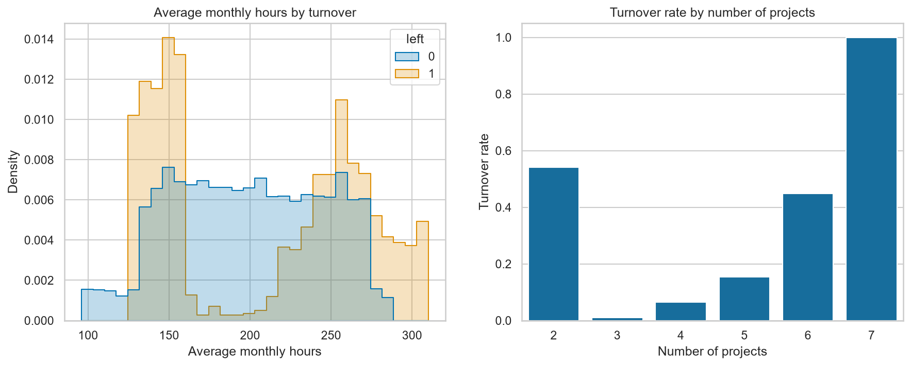
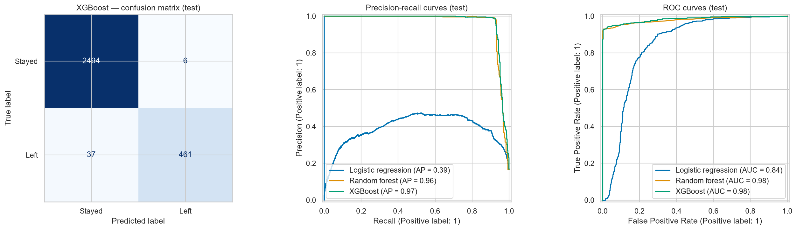
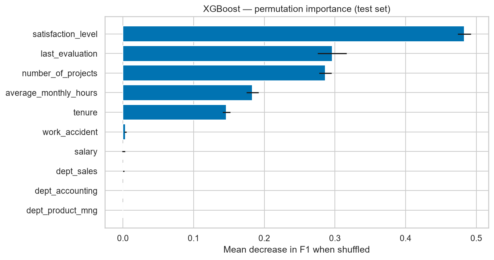

# Salifort Motors — Employee Turnover Analysis and Prediction

Exploratory analysis, statistical testing and machine learning models to understand
and predict employee turnover from an HR dataset.


## Business problem

The HR department of *Salifort Motors* (a fictional company) wants to improve
employee retention. Replacing an employee is costly, so HR asks:

1. Which factors are associated with employees leaving?
2. Can we flag employees at risk of leaving early enough to intervene?

The task is framed as a **binary classification** problem (`left` = 1 if the
employee left). Missing an employee who will leave (false negative) is assumed to
be more costly than a false alarm, and the classes are imbalanced (16.6% leavers),
so models are compared with recall, precision, F1 and PR-AUC rather than accuracy.

## Dataset

- **Source:** [HR Analytics and Job Prediction (Kaggle)](https://www.kaggle.com/datasets/mfaisalqureshi/hr-analytics-and-job-prediction)
- 14,999 rows × 10 columns: satisfaction, last evaluation, number of projects,
  monthly hours, tenure, work accident, promotion, department, salary band and
  the target `left`.
- **The data is not included in this repository.** Download `HR_comma_sep.csv`
  from Kaggle and place it in `data/raw/`. Refer to the Kaggle page for its terms
  of use.

## Methodology

1. **Cleaning** — snake_case column names, no missing values, 3,008 exact
   duplicate rows (20%) removed → 11,991 employees. Tenure outliers (> 5.5 years)
   kept as valid observations.
2. **EDA** — distributions and turnover rates by satisfaction, workload, tenure,
   salary, promotion and department.
3. **Statistical analysis** — Mann–Whitney U (satisfaction) and chi-square tests
   (salary, department) with effect sizes.
4. **Feature engineering** — ordinal encoding of salary, one-hot encoding of
   department (reference category dropped), VIF multicollinearity check.
5. **Modeling** — logistic regression (baseline), random forest and XGBoost, all
   class-imbalance aware. Hyperparameters tuned with `GridSearchCV` and 5-fold
   stratified cross-validation; scaling inside a pipeline to avoid leakage.
6. **Selection and threshold** — model chosen by cross-validated F1; decision
   threshold tuned on out-of-fold training predictions.
7. **Evaluation** — single evaluation of the selected model on a held-out 25%
   test set; confusion matrix, PR and ROC curves, permutation importance.
8. **Robustness check** — retraining without `satisfaction_level` and
   `last_evaluation`, which may not be available before an employee leaves.

## Key EDA findings

- Leavers report much lower satisfaction (median 0.41 vs 0.69; large effect size).
- Workload has a **U-shaped** relationship with turnover: turnover is lowest with
  3–4 projects and every employee with 7 projects left.
- Turnover peaks at 5 years of tenure (45%) and is zero from 7 years.
- Turnover falls with salary band (20.5% low, 14.6% medium, 4.8% high).
- Department differences are statistically significant but negligible in size.



## Results

**Model selection (5-fold stratified CV on the training set, mean values)**

| Model | Precision | Recall | F1 | PR-AUC | ROC-AUC |
|---|---|---|---|---|---|
| Logistic regression | 0.405 | 0.822 | 0.542 | 0.374 | 0.834 |
| Random forest | 0.974 | 0.914 | 0.943 | 0.963 | 0.982 |
| **XGBoost (selected)** | 0.965 | 0.926 | **0.945** | 0.966 | 0.983 |

XGBoost was selected by CV F1, although the difference with the random forest is
smaller than the fold-to-fold standard deviation (≈ 0.011): both models are
practically equivalent.

**Final evaluation on the held-out test set (2,998 employees, 498 leavers)**

| Model | Threshold | Precision | Recall | F1 | PR-AUC |
|---|---|---|---|---|---|
| **XGBoost (selected)** | 0.78* | 0.987 | 0.926 | **0.955** | 0.968 |
| Random forest | 0.50 | 0.985 | 0.924 | 0.953 | 0.963 |
| Logistic regression | 0.50 | 0.415 | 0.819 | 0.551 | 0.386 |
| XGBoost without satisfaction & evaluation | 0.79* | 0.879 | 0.892 | 0.885 | 0.910 |

\* Threshold maximising F1 on out-of-fold training predictions (the test set was
not used to choose it).

- The selected model identifies **461 of the 498 leavers** in the test set and
  wrongly flags 6 of the 2,500 employees who stayed.
- Test results match the cross-validation estimates, so there is no sign of
  overfitting.
- **Most important features** (permutation importance): satisfaction level, last
  evaluation, number of projects, average monthly hours and tenure. Salary,
  promotion and department add almost nothing once these are known.
- **Robustness:** without survey-based scores the model still reaches F1 0.885,
  using only workload, tenure and HR records.




## Business recommendations

1. **Monitor workload:** review employees with 2 projects (possible under-use) and
   with 6 or more projects or very high monthly hours (possible burnout).
2. **Focus on the 3–5-year tenure window**, where turnover peaks (45% at 5 years).
3. **Run regular satisfaction surveys** and act on low scores.
4. **Use the model only as decision support** for voluntary retention
   conversations, with human review, after validating it on real, current HR data.

## Limitations

- The data collection process is undocumented and some patterns suggest the data
  may be synthetic, so the high scores are unlikely to transfer to real HR data.
- No employee ID or timestamps: duplicates cannot be verified and temporal
  validation is not possible.
- Satisfaction and evaluation scores may be measured close to the departure
  (see the robustness check).
- Results describe associations, not causal effects.
- Fairness across departments and salary bands has not been audited.

## Repository structure

```
├── data/raw/            # place the Kaggle CSV here (not versioned)
├── figures/             # figures exported by the notebook
├── notebooks/
│   └── employee_turnover_analysis.ipynb
├── src/salifort/        # loading, cleaning, encoding and evaluation helpers
├── tests/               # unit tests (pytest)
├── pyproject.toml
└── requirements.txt
```

## How to reproduce

```bash
git clone https://github.com/<your-user>/salifort-motors-employee-retention.git
cd salifort-motors-employee-retention
python -m venv .venv
.venv\Scripts\activate        # Windows  (macOS/Linux: source .venv/bin/activate)
pip install -r requirements.txt
# download HR_comma_sep.csv from Kaggle into data/raw/
pytest
jupyter notebook notebooks/employee_turnover_analysis.ipynb   # or open it in VS Code
```

## Acknowledgements

The business scenario comes from the capstone project of the Google Advanced
Data Analytics Professional Certificate (Coursera). The analysis, code and
evaluation in this repository were developed independently.

## License

Code released under the [MIT License](LICENSE). The dataset is subject to its own
terms on Kaggle.
